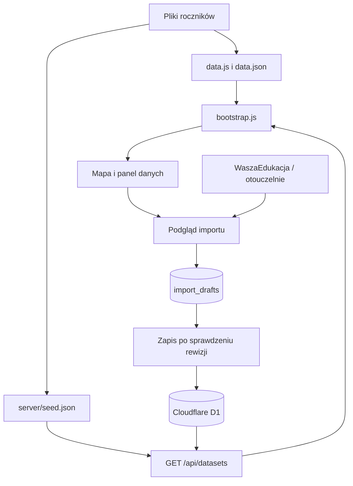

# Architektura i API

## Warstwy

Interfejs HTML/CSS/JavaScript znajduje się w `licea/public/atlas/`. Leaflet wyświetla mapę, a MarkerCluster grupuje szkoły. `app.js` obsługuje listę, filtry, karty i historię; `data-manager.js` obsługuje import i eksport. React/Vinext zapewnia otoczenie serwerowe i API. `app/page.tsx` przekierowuje na atlas.



`bootstrap.js` odczytuje API z limitem 12 sekund. Przy błędzie pozostawia dane początkowe i wyświetla ostrzeżenie. `server/store.ts` łączy seedy z D1; baza zastępuje całe roczniki o tych samych latach.

## Przechowywanie

| Warstwa | Rola |
| --- | --- |
| `public/atlas/data/rankings-ROK.json` | Migawki roczników, schemaVersion 1 |
| `public/atlas/data/index.json` | Katalog lat i rok domyślny |
| `public/atlas/data.js`, `data.json` | Generowany pakiet przeglądarkowy i najnowsza migawka |
| `server/seed.json` | Generowana mapa roczników serwera |
| D1: `annual_snapshots` | `year` jako klucz, JSON `payload`, licznik `revision` |
| D1: `import_drafts` | `id`, JSON `payload`, `created` w milisekundach; ważność godzina |

Stabilne `schools[].id` łączy szkołę między latami. Brak wyniku nie jest zerem. Historyczne rankingi nie potwierdzają dawnych lokalizacji lub oferty: adresy korzystają z bazy 2026, a historyczne profile pozostają puste. Dokładny schemat: [DANE.md](../licea/DANE.md).

## API

Odpowiedzi JSON mają `Cache-Control: no-store`. POST wymaga `Content-Type: application/json` i nagłówka `Origin` równego originowi żądania. Limit treści żądania wynosi 100000 znaków.

| Metoda i ścieżka | Wejście | Wynik |
| --- | --- | --- |
| `GET /api/datasets` | Brak | `{datasets, revisions}`; błąd odczytu: 503 |
| `POST /api/import/preview` | `{source, year}`, source: `wasza` lub `oto` | Id podglądu, rok, źródło, URL, SHA-256, wiersze i podsumowanie |
| `POST /api/import/prepare` | `{id, mappings}` | `{dataset}` do pobrania, bez zapisu rocznika |
| `POST /api/import/commit` | `{id, mappings}` | `{year, dataset, message}` po zapisie |

`mappings` mapuje indeks wiersza importu na id szkoły albo `__new__`. Nowa karta nie otrzymuje automatycznie adresu i współrzędnych. Import GUI nie obejmuje Perspektyw. Błędy walidacji, pobierania i wygasły podgląd zwracają 400 z `{error}`; konflikt rewizji zwraca 409.

Przykład w konsoli przeglądarki otwartej na lokalnej aplikacji:

```javascript
const response = await fetch('/api/import/preview', {
  method: 'POST',
  headers: { 'Content-Type': 'application/json' },
  body: JSON.stringify({ source: 'oto', year: 2025 })
});
const preview = await response.json();
console.log(response.status, preview);
```

Przeglądarka dołącza Origin. Żądanie pobiera dane z internetu i zapisuje podgląd w D1, ale jeszcze nie zmienia rocznika.

## Przebieg importu

1. Serwer buduje dozwolony URL wydawcy, ogranicza przekierowania, czas pobrania do 25 sekund i stronę do 5 MB.
2. `server/rankings.mjs` parsuje i sprawdza tabelę. Podgląd zawiera bieżącą rewizję i SHA-256 pobranej strony.
3. Użytkownik sprawdza wyniki i przypisuje nierozpoznane szkoły. Przygotowanie JSON nie zmienia rocznika.
4. Zapis scala ranking wybranego wydawcy, zachowując inne źródła. Warunkowy zapis SQL zwiększa rewizję i odrzuca nieaktualny podgląd.
5. `importAudit` zapisuje źródło, URL, SHA-256 i czas importu; wykorzystany podgląd zostaje usunięty.

## Ograniczenia

Origin nie rozpoznaje administratora. Ochrona dostępu zależy od wdrożenia Sites; publiczny zapis wymaga dodania uprawnień. Pliki i D1 to oddzielne kanały aktualizacji: Python nie synchronizuje produkcyjnej bazy. Zmiany HTML wydawcy mogą wymagać korekty parsera.
